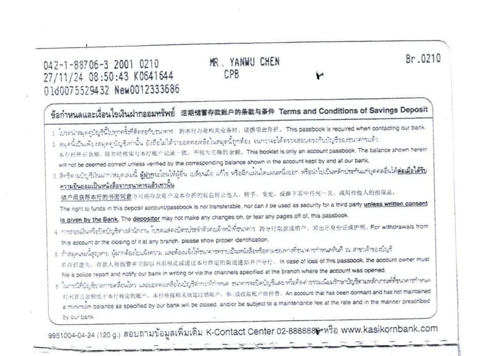
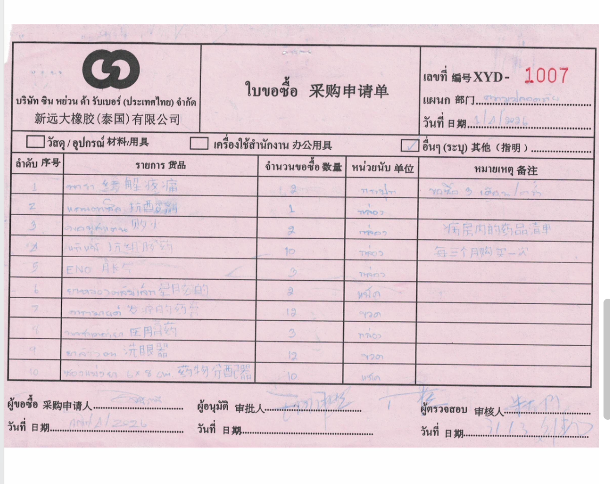
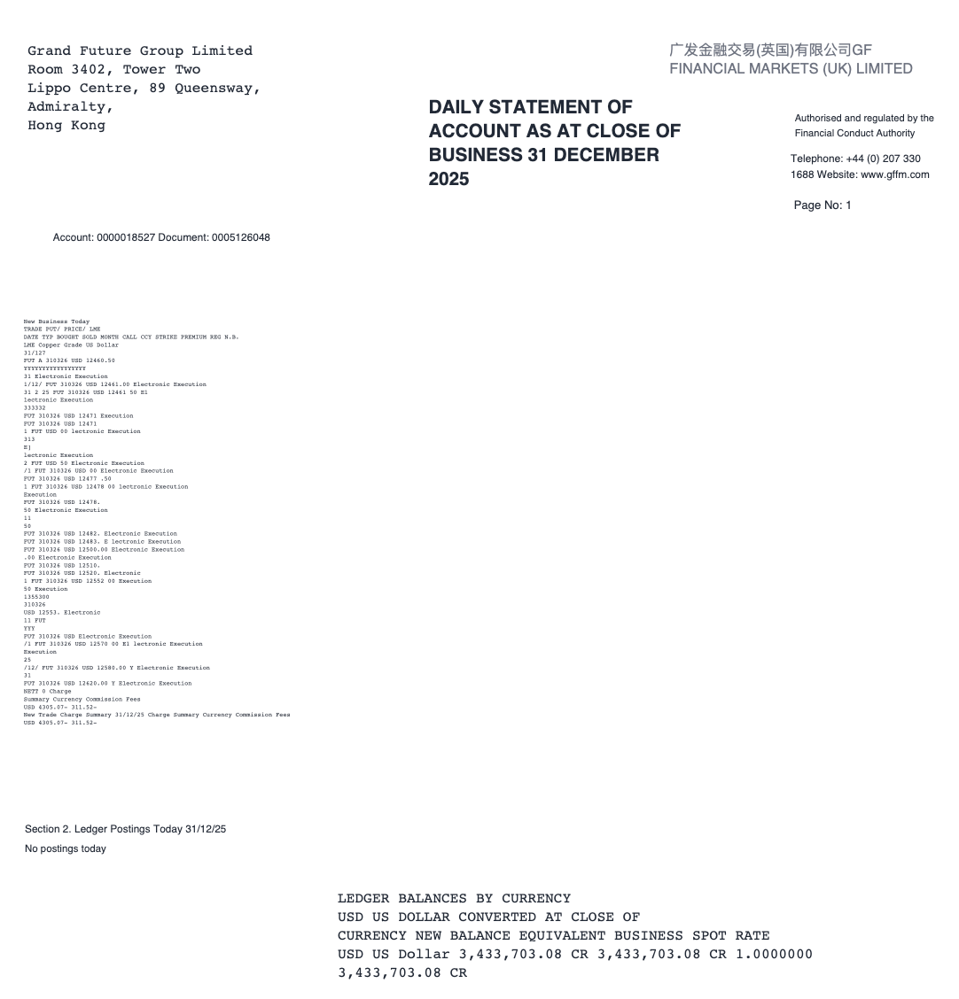
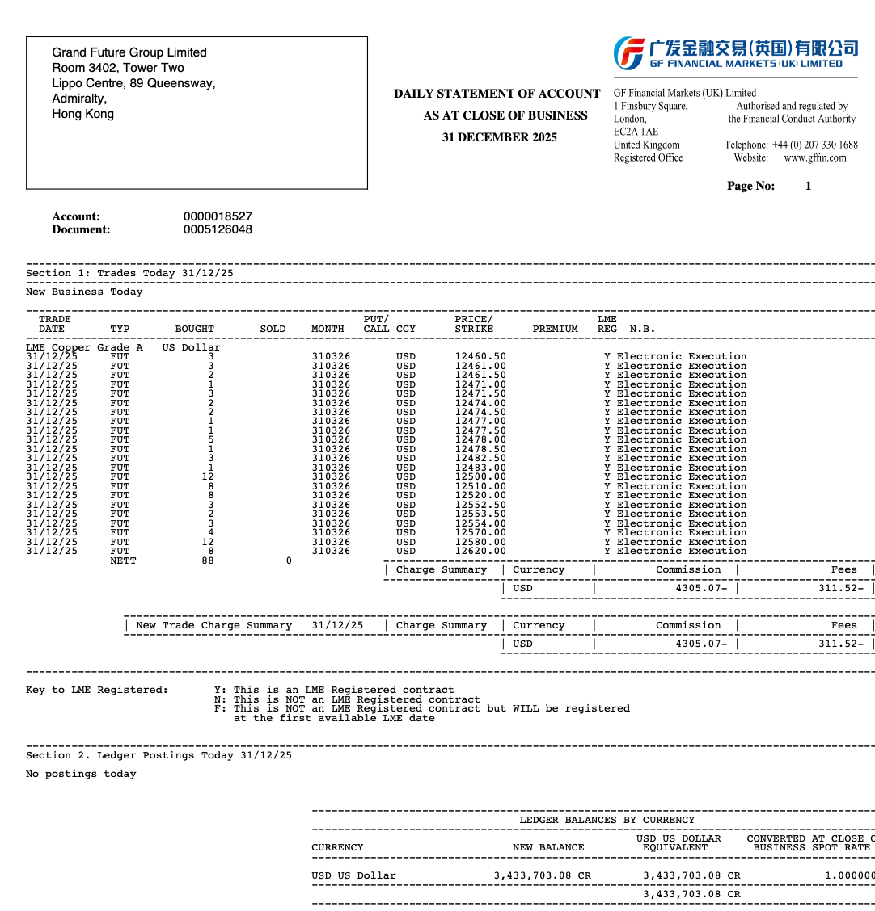

# PDF 翻译与扫描件翻译 — TODO List

> **项目：** PDF 翻译与扫描件翻译  
> **更新时间：** 2026-10-16  
> **工时：** 38天（工时远不足以完成PDF排版保持任务）  
> **负责人：** 胡海波  

## 📌 优先级说明

| 优先级 | 说明 | 处理要求 |
|:---:|---|---|
| 🔴 **P0** | 阻塞 / 紧急 | 必须立即处理 |
| 🟠 **P1** | 高优先级 | 本周完成 |
| 🟡 **P2** | 普通优先级 | 有空处理 |
| 🟢 **P3** | 低优先级 | 备选 / 优化项 |

---
## 📌 解决方案沟通与风险点 [communication]
- 加工时
- 扫描件的 PDF 处理难以保持原始排版
- 在mineru兜底方案中，4.0版本不支持华为Ascend系列显卡，且公司内部T4卡、A40卡驱动、runtime版本过低，且资源已被占用。所以需要英伟达显卡资源
- 扫描件 PDF 质量过低，或文档旋转导致解析异常，如下所示
  <div align="center">
    
    
  </div>

## 📝 待办任务 [TODO]

### 开发任务
- [ ] 🔴 **P0｜平台接口适配**
  - **截止日期：** 2026-10-31
  - **任务描述：** 构建数科平台调用接口；完成 PO 接口设计；实现翻译结果推送机制。
  - **工作难点：** PO 接口设计不熟悉，需要数科人员协助（；

- [ ] 🔴 **P0｜Layout 等组件耗时与预加载**
  - **截止日期：** 2026-10-31
  - **任务描述：** 对于扫描件 PDF，需要预加载 Layout 等组件，以提高翻译效率。
  - **工作难点：** 

### 算法任务


- [ ] 🟡 **P2｜PDF 扫描件 OCR 文字层处理**
  - **截止日期：** ？？？
  - **任务描述：** 对于扫描件 PDF，需要使用 OCR 创建文字层。
  - **工作难点：** 算法思路不清晰。
  - **算法说明：** 使用 OCR 模型识别扫描件 PDF 文字层，将识别结果添加到 PDF 中。


## 🚧 进行中 [IN PROGRESS]

- [ ] 🟠 **P1｜mineru 4.0版本适配**
  - **截止日期：** 2026-10-20
  - **任务描述：** mineru 4.0版本虽然可以在CPU上运行，但是性能较差，需要适配到英伟达显卡上。
  - **工作难点：** 驱动、runtime版本低。
  - **算法说明：** 借助社区信息尝试在低版本 image 中创建 mineru docker 镜像。

- [ ] 🟡 **P2｜标准 PDF 中间表示**
  - **截止日期：** 2026-10-20
  - **任务描述：** 需要调研 PDF 中间表示字段有哪些、标准化处理过程是什么、包含预处理和后处理等等。
  - **工作难点：** 算法思路不清晰。
  - **算法说明：** 一个 Page 中大概包含以下字段：
    ```
    Page
    ├── 几何信息
    │   ├── mediabox      → 页面原始尺寸
    │   ├── cropbox       → 可见区域
    │   └── unit          → 坐标单位
    │
    ├── 内容元素
    │   ├── pdf_character → 每个字符（位置、字体、大小）
    │   ├── pdf_paragraph → 段落（由字符组成）
    │   ├── pdf_figure    → 图片/图形
    │   ├── pdf_curve     → 矢量曲线
    │   ├── pdf_rectangle → 矩形
    │   └── pdf_form      → Form XObject
    │
    ├── 资源信息
    │   ├── pdf_font      → 字体定义
    │   └── pdf_xobject   → XObject 引用
    │
    ├── 布局信息
    │   └── page_layout   → 排版布局
    │
    └── 原始数据
        ├── base_operations → 原始 PDF 操作码
        └── page_number     → 页码
    ```
  - **算法健壮性说明：** 
    1. 若一个 PDF 在不同的 PDF 处理工具中进行了多次编辑，可能存在图层的重叠，翻译结果也会出现页面内容重叠
    2. 若标准 PDF 和扫描件 PDF 混用，不会翻译扫描件内容
  - **后处理说明：** 
    1. base_operations 用于双语对照，恢复原始 PDF
    2. 一般只用到 pdf_character 字段进行翻译任务，*pdf_figure 需要根据 OCR 识别结果进行处理*
  - **排版保持说明：** 
    1. 翻译后字符大小需要与原始字符大小保持一致，否则会导致排版错误


## ✅ 已完成任务 [DONE]

- [x] 🟠 **P1｜市场化产品调研**
  - **完成日期：** 2026-09-04
  - **任务描述：** 调研市场上的 PDF 翻译产品，分析其功能、价格、用户评价等。
  - **调研结论：**
    1. 暂未找到完全符合需求的开源 PDF 翻译产品，可考虑基于现有翻译插件（如 Zotero 翻译插件）进行二次开发。
    2. 扫描件 PDF 需要先进行 OCR 识别，如何在翻译后准确还原原始文档排版，是当前需要重点解决的技术难点。

- [x] 🟡 **P2｜MinerU 4.0 排版保持功能部署测试**
  - **完成日期：** 2026-10-12
  - **任务描述：** 部署 MinerU 4.0 排版保持功能，测试其在扫描件 PDF 上的排版保持效果。
  - **示例：**<div align="center">
      
      
    </div>
  - **测试结论：**
    1. 排版保持功能难以适配国外的扫描件 PDF，特别是表格随意排版的情况。
    
- [ ] 🟡 **P2｜PDF 格式检查**
  - **完成日期：** 2026-10-13
  - **任务描述：** 检查上传的 PDF 文件是否符合处理要求，包括文件大小、文件格式等；优先支持符合标准规范的 PDF 文件。
  - **工作难点：** PDF 可能存在错误格式，如压缩后的 PDF 文件、加密后的 PDF 文件等，不同的应用创造的 PDF 文件格式也不同。
  - **算法说明：** 公开资料显示大部分预处理操作是根据 issue 逐步积累的修复方案，并不存在标准操作。
  - **PDF 复杂性说明：**
    1. 不同工具生成的 PDF 文件格式不同 （Word、Photoshop、扫描件、开源库等）
    2. 旧版 PDF 和新版 PDF 混用
    3. 某些 PDF 编辑器生成的有问题的文件 
  - **常规处理办法：**
    1. 使用 PyMuPDF 重新保存 PDF 文件，但 PyMuPDF 如何修复对象、序列化对象等操作尚不明确
    2. 检查 PDF 常规属性，如加密状态、页数、页面有效性等
    3. 交叉引用表、Filter 类型检查 （该内容根据 issue 获得的修复方案）
  - **已实现功能说明：**
    1. 借助开源方法实现 PyMuPDF 重新保存设置、交叉引用表、Filter类型检查
  - **备注：**
    1. 该功能项会增加程序健壮性，对于存在格式问题的 PDF，并不能保证检查成功，因此可能存在翻译乱码问题，且我认为该问题需要用户配合处理

- [ ] 🟡 **P2｜PDF 扫描件识别**
  - **截止日期：** 2026-10-15
  - **任务描述：** 没人关注 PDF 是扫描件 PDF 还是结构化 PDF 文件，需要根据文件内容判断并进行分类。
  - **工作难点：** 与 PDF 格式检查相似，算法思路不清晰。
  - **算法说明：** 使用 PDF_creater 比较去除文字层后的两个PDF相似度，判断是否为扫描件。
  - **TODO：**
    1. 对于扫描件 PDF，需要使用 OCR 创建文字层。
    2. 在重建 PDF 阶段，需要对文字层增加一个蒙版，使得文字层显示在最上层。

- [ ] 🟠 **P1｜Layout 解析**
  - **截止日期：** 2026-10-18
  - **任务描述：** Layout 模型有哪些，输出格式是什么，怎么利用 Layout 模型解析 PDF 文件的排版信息。
  - **工作难点：** 算法思路不清晰。
  - **算法说明：** 先使用 Layout 模型解析 PDF 文件的排版信息，比如页面布局、段落、图片、图片等。再使用 IR 中间表示合成字符信息，比如fallback_line。
  - **TODO：** 研究不同 Layout 模型的输出格式，以及如何利用这些输出格式解析 PDF 文件的排版信息。

## 📦 搁置 / 废弃任务 [ARCHIVE]

- [ ] 🟡 **P2｜PDF 格式检查测试**
  - **搁置原因：** 当前工时不足，暂缓处理。

- [ ] 🟠 **P1｜合并字符为段落**
  - **截止日期：** 2026-10-18
  - **任务描述：** 对于扫描件 PDF，需要合并字符为段落，将识别结果添加到 PDF 中。
  - **工作难点：** 算法思路不清晰。
  - **算法说明：** 
  - **搁置原因：** 复杂度较高。

---

## 📊 项目推进原则

- **优先处理 P0：** 优先解决阻塞项目推进的关键任务。
- **及时更新进度：** 任务进入执行阶段后，更新进度、卡点及下一步计划。
- **完成后及时归档：** 将已完成任务移入 DONE，并记录关键结论。
- **搁置任务保留原因：** 记录搁置背景，便于后续重新评估。

```
pdf_paragraph 的修改：
├── 功能性（影响最终输出）
│   ├── il_creater_active.py   → 解析时记录文本段落
│   ├── paragraph_finder.py    → 将字符聚合为段落（核心！）
│   ├── il_translator.py       → 翻译后的段落
│   └── typesetting.py         → 排版后的段落
│
└── 调试性（仅 debug 模式）
    ├── layout_parser.py       → 布局区域标签
    ├── detect_scanned_file.py → 扫描分数标签
    └── table_parser.py        → 表格标签

pdf_rectangle 的修改：
├── 功能性
│   └── il_creater_active.py   → 解析时记录矩形图形
│
└── 调试性（仅 debug 模式）
    ├── layout_parser.py       → 布局区域边框
    ├── table_parser.py        → 表格边框
    ├── paragraph_finder.py    → 段落边框
    └── add_debug_information.py → 各种调试边框
    ```